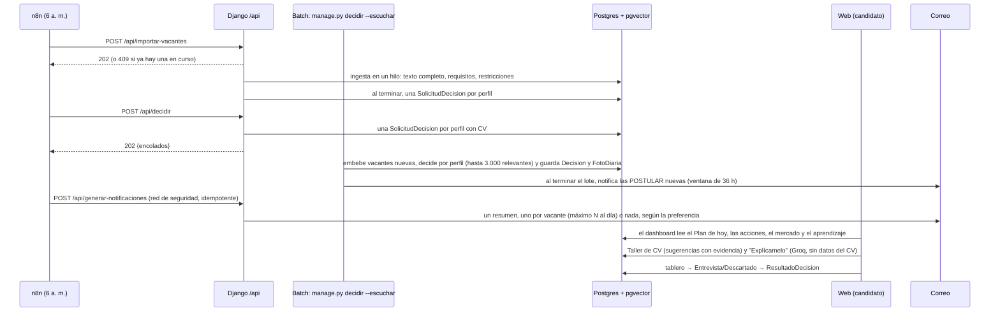

# Fase 3: el flujo diario de punta a punta



## Cómo levantarlo

```bash
infra/postgres/levantar.sh                               # Postgres 17 + pgvector (Podman)
.venv/bin/python manage.py migrate
.venv/bin/python manage.py runserver --insecure 0.0.0.0:8000
.venv/bin/python manage.py decidir --escuchar            # otra terminal: el batch con los modelos cargados
# n8n: importar n8n/workflow-matches-diarios.json y poner N8N_SCORING_TOKEN (ver n8n/README.md)
```

> **Cuidado:** `0.0.0.0` expone el servidor de desarrollo a toda la red (Wi-Fi compartida incluida). Úsalo solo en
> una red de confianza, y **nunca con `DJANGO_DEBUG=true`**: una página de error mostraría datos del CV. Es más seguro
> escuchar solo en la puerta de enlace de Podman (`podman network inspect podman` da la IP, por ejemplo
> `runserver --insecure 10.88.0.1:8000`).

Variables útiles en `.env`:
- `GROQ_API_KEY` para "Explícamelo"; sin ella se usa un texto de respaldo.
- SMTP (`DJANGO_EMAIL_BACKEND` y `EMAIL_*`) para que los correos salgan; si no, se imprimen en la terminal.
- `SOCIAL_*` para el inicio de sesión social.

**B1 (MCP de Magneto) queda apagado** hasta que el equipo revise los términos de uso. Para activarlo hay que poner
`SCOUTLY_MAGNETO_MCP=1`, las URLs OAuth y `SCOUTLY_CLAVE_TOKENS`.

## Qué cubre cada paso del objetivo "conseguir entrevistas"

| Eslabón (propuestas §2) | Pieza |
|---|---|
| Encontrar la vacante correcta | Preselección exacta, cobertura y DESCARTAR con su motivo |
| Llegar a tiempo | Frescura en el Plan de hoy, la marca "Postular hoy" y la notificación diaria |
| Pasar el filtro eliminatorio | "Preguntas de la empresa" (B1, apagado) |
| Que el CV muestre el ajuste | Taller de CV: sugerencias con la evidencia y texto para copiar |
| No saturar a la misma empresa | Plan de hoy con una vacante por empresa |
| Medir y aprender | ResultadoDecision al mover el tablero (los datos para calibrar) |
